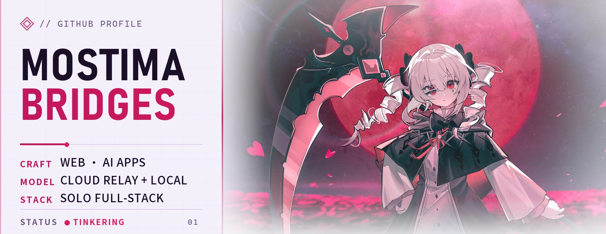
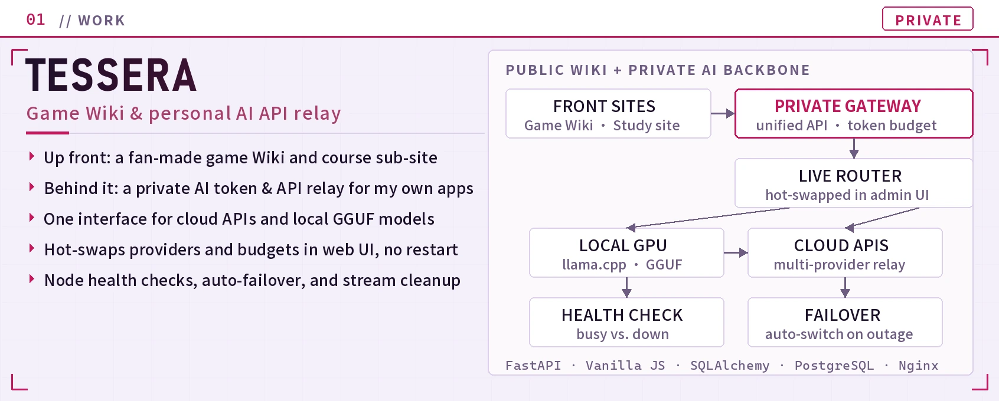
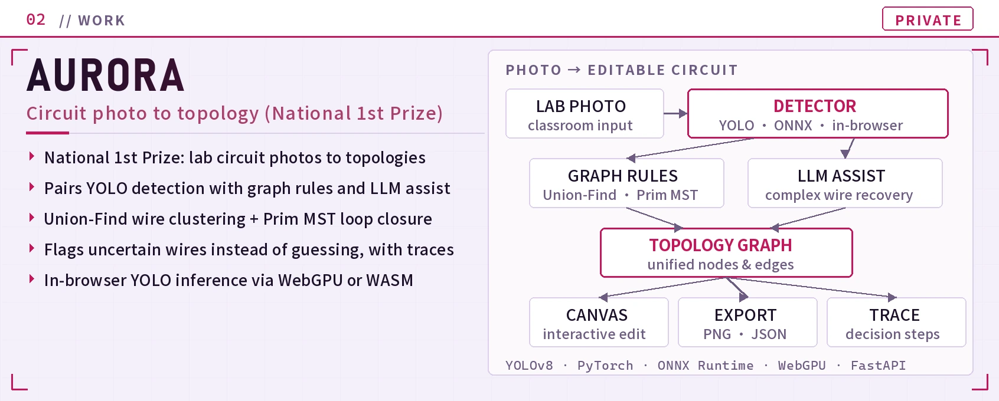
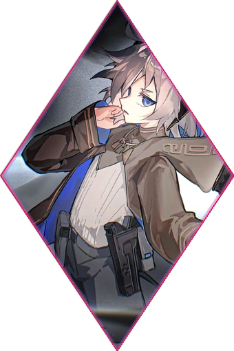

<!--
  MAINTAINING THIS FILE
  =====================
  * The pills at the top are the only route between README.md (中文) and
    README.en.md. Keep the pair symmetric: check_readme.py fails if one page
    stops linking to the other.
  * Every image is self-hosted under assets/ except the typing subtitle and the
    two skillicons rows. If a third-party row disappears the page still reads,
    because the same stack is spelled out in prose right underneath.
  * dark / light switches with <picture> + prefers-color-scheme, and the plain
     fallback is always the LIGHT asset, so a client that ignores the media
    query does not paint a dark poster on a white page.
  * Never put a bare comma in a srcset: HTML reads it as a candidate separator
    and keeps only the first slice. skillicons takes its list as `?i=py,ts,js`,
    so the comma stays percent-encoded as %2C. check_readme.py enforces this.
  * Markdown inside 
 IS parsed by GitHub (a CommonMark HTML
    block ends at a blank line) — keep those blank lines.
  * The hero and project-card artwork is the -en- variant, so its HUD and diagram
    labels are English too. The portrait, dividers, monogram and the language
    pills are shared between the two pages.
  * After editing: python scripts/check_readme.py   (CI runs the same script)
-->

<!-- ======================= LANGUAGE SWITCH / 语言切换 ======================= -->

  
  &nbsp;
  

<!-- ============================== HERO ============================== -->

<picture>
  <source media="(prefers-color-scheme: dark)" srcset="./assets/hero/hero-en-dark.webp" />
  <source media="(prefers-color-scheme: light)" srcset="./assets/hero/hero-en-light.webp" />
  
</picture>

**Strands** · [@MostimaBridges](https://github.com/MostimaBridges)

Solo developer building web apps and AI tools — started with a hand-coded game Wiki, and kept building tools I actually use every day.

<picture>
  <source media="(prefers-color-scheme: dark)"
          srcset="https://readme-typing-svg.demolab.com?font=JetBrains+Mono&weight=500&size=19&duration=2600&pause=800&center=true&vCenter=true&width=900&height=46&color=FF4D7E&lines=Game+Wiki+up+front%2C+private+AI+relay+in+back%3BCloud+APIs+%2B+local+GGUF+on+a+home+GPU%3BLab+circuit+photos+to+editable+topologies%3BWritten+on+Windows%2C+kept+runnable+on+Linux" />
  <source media="(prefers-color-scheme: light)"
          srcset="https://readme-typing-svg.demolab.com?font=JetBrains+Mono&weight=500&size=19&duration=2600&pause=800&center=true&vCenter=true&width=900&height=46&color=C2185B&lines=Game+Wiki+up+front%2C+private+AI+relay+in+back%3BCloud+APIs+%2B+local+GGUF+on+a+home+GPU%3BLab+circuit+photos+to+editable+topologies%3BWritten+on+Windows%2C+kept+runnable+on+Linux" />
  
</picture>

<picture>
  <source media="(prefers-color-scheme: dark)" srcset="./assets/ornaments/divider-dark.webp" />
  <source media="(prefers-color-scheme: light)" srcset="./assets/ornaments/divider-light.webp" />
  
</picture>

<!-- =========================== CONTRIBUTIONS =========================== -->
## // Contributions

<picture>
  <source media="(prefers-color-scheme: dark)" srcset="./assets/generated/snake-dark.svg" />
  <source media="(prefers-color-scheme: light)" srcset="./assets/generated/snake-light.svg" />
  
</picture>

Rebuilt once a day by GitHub Actions — see [`.github/workflows/snake.yml`](.github/workflows/snake.yml).

<picture>
  <source media="(prefers-color-scheme: dark)" srcset="./assets/ornaments/divider-dark.webp" />
  <source media="(prefers-color-scheme: light)" srcset="./assets/ornaments/divider-light.webp" />
  
</picture>

<!-- ============================== STACK ============================== -->
## // STACK

<picture>
  <source media="(prefers-color-scheme: dark)" srcset="https://skillicons.dev/icons?i=py%2Cts%2Cjs%2Cfastapi%2Cpostgres%2Csqlite%2Cnginx%2Cgit&theme=dark&perline=8" />
  <source media="(prefers-color-scheme: light)" srcset="https://skillicons.dev/icons?i=py%2Cts%2Cjs%2Cfastapi%2Cpostgres%2Csqlite%2Cnginx%2Cgit&theme=light&perline=8" />
  
</picture>

<picture>
  <source media="(prefers-color-scheme: dark)" srcset="https://skillicons.dev/icons?i=pytorch%2Copencv%2Cvue%2Cvite%2Clinux%2Cwindows%2Cpowershell%2Cgithub&theme=dark&perline=8" />
  <source media="(prefers-color-scheme: light)" srcset="https://skillicons.dev/icons?i=pytorch%2Copencv%2Cvue%2Cvite%2Clinux%2Cwindows%2Cpowershell%2Cgithub&theme=light&perline=8" />
  
</picture>

<picture>
  <source media="(prefers-color-scheme: dark)" srcset="./assets/icons/ai-tools-dark.svg" />
  <source media="(prefers-color-scheme: light)" srcset="./assets/icons/ai-tools-light.svg" />
  
</picture>

Python and plain JavaScript are my daily drivers, with Vue and TypeScript when an interface calls for a bit more structure. On the model side it's `llama.cpp` with GGUF; on the vision side, YOLO paired with `ONNX Runtime`. Deployment is mostly Nginx in front of Windows services managed with PowerShell scripts, with pieces moving over to Linux bit by bit. Most of my coding happens alongside Copilot and Codex, and lately I've been poking at agent projects like DeepSeek Harness (DSH) and AstrBot on the side.

<picture>
  <source media="(prefers-color-scheme: dark)" srcset="./assets/ornaments/divider-dark.webp" />
  <source media="(prefers-color-scheme: light)" srcset="./assets/ornaments/divider-light.webp" />
  
</picture>

<!-- ============================== ABOUT ============================== -->
## // ABOUT

Overworked Chinese college student, still can't find a job. With nothing lined up yet, I'm mostly keeping busy maintaining the sites and tools I use myself.

Most of my full-stack tinkering started with building a Wiki site for a game I liked—just a few static pages at first, which eventually grew into its own backend and personal services. I'd rather build things I actually want to keep opening months later than one-off demos, and usually that just means writing small scripts so I have less repetitive work to do.

<picture>
  <source media="(prefers-color-scheme: dark)" srcset="./assets/ornaments/divider-dark.webp" />
  <source media="(prefers-color-scheme: light)" srcset="./assets/ornaments/divider-light.webp" />
  
</picture>

<!-- ============================== WORK ============================== -->
## // WORK

Both repositories below are private, so the source isn't public — this is just a look at what they actually do and how they came together.

<picture>
  <source media="(prefers-color-scheme: dark)" srcset="./assets/projects/tessera-en-dark.webp" />
  <source media="(prefers-color-scheme: light)" srcset="./assets/projects/tessera-en-light.webp" />
  
</picture>

#### TESSERA · game Wiki & personal AI relay `private`

That game Wiki I mentioned started out as a front-end class assignment: static HTML and jQuery for a lore Wiki about a game I like, with one page each for characters, items, worldbuilding, and guides. (The very first commit message was literally "1", and the one adding lazy loading was "lazy loading aaaaaa".) Editing raw HTML for every new entry got old fast, so I moved the data out, bolted on a backend, and pulled a course-notes sub-site under the same roof. Those original pages — along with the course-notes site — are still the front door, and the front end is still plain JavaScript with no framework and no bundler.

What takes most of my time now sits behind them: a private AI token and API relay built strictly for myself, never opened to external users. Any tool or page I write talks to this one endpoint, whether a request ends up hitting a cloud API or a local GGUF model running on my GPU at home. I can tweak provider weights, adjust budgets, or swap routes straight from a web admin page without restarting anything. It also tells the difference between a busy queued node and a dead one, fails over to another upstream when something drops, strips stray metadata out of token streams before it clutters chat history, and ships with small ops scripts so it stays out of my hair.

<picture>
  <source media="(prefers-color-scheme: dark)" srcset="./assets/projects/aurora-en-dark.webp" />
  <source media="(prefers-color-scheme: light)" srcset="./assets/projects/aurora-en-light.webp" />
  
</picture>

#### AURORA · circuit recognition & topology recovery `private`

This started as a competition project (and ended up winning a national first prize). The goal is straightforward: take a smartphone photo of a classroom lab circuit and turn it into an editable, verifiable circuit diagram.

Spotting resistors, switches, and power supplies with YOLO turns out to be the easy half. The real headache is the wires — crossed jumpers, desk glare, and awkward camera angles make it way too easy for a vision model to hallucinate connections that aren't really there. Instead of letting it guess, we combine visual detection with graph algorithms and LLM reasoning to untangle the wiring. Whenever the photo doesn't give enough evidence for a connection, it flags that wire for a human to confirm rather than inventing one, and records how every edge was decided so mistakes can be traced back. The detector can also run straight inside the browser via ONNX Runtime, so you don't even have to wait on a server just to test an image.

<picture>
  <source media="(prefers-color-scheme: dark)" srcset="./assets/ornaments/divider-dark.webp" />
  <source media="(prefers-color-scheme: light)" srcset="./assets/ornaments/divider-light.webp" />
  
</picture>

<!-- ============================== NOTES ============================== -->
## // NOTES

The title card, project cards, dividers, monogram, and language pills are generated by <a href="./scripts/build_assets.py">scripts/build_assets.py</a>, so the palette stays in one place.

