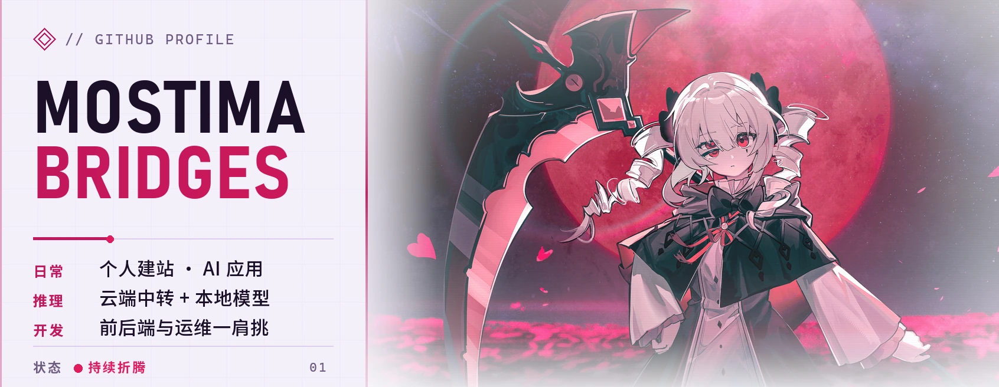
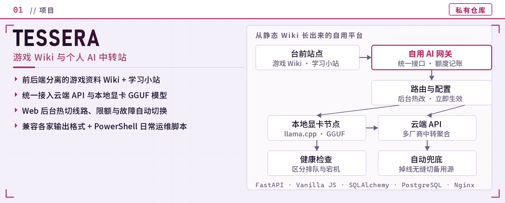
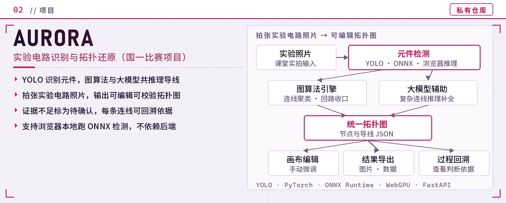
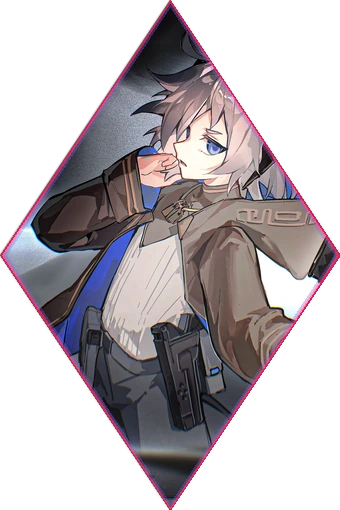

<!--
  维护说明
  ========
  * 图片全部放在 assets/ 下自己托管。只有 typing 副标题和 Skill Icons 走第三方，
    它们挂掉不影响阅读。
  * 中英切换：顶部那两枚胶囊是 README.md 与 README.en.md 之间唯一的入口，
    两边链接必须成对存在，check_readme.py 会检查互链。
  * dark / light 用 <picture> 切换，兜底的  一律指向 light 版本，
    这样不认 media query 的客户端也不会在浅色页面上出现一块黑图。
  * srcset 里绝对不能出现裸逗号。HTML 用逗号分隔 srcset 的候选图，GitHub 会照做，
    于是 "?i=py,ts,js" 只剩第一个候选 ":py"，整行只渲染出一个图标。带逗号的 URL
    一律写成 %2C；check_readme.py 会拦这个。
  * 
 里的 markdown 会被正常解析，那些空行别删。
  * 改完跑 python scripts/check_readme.py，这条也在 CI 里跑。
-->

<!-- ======================= 语言切换 / LANGUAGE SWITCH ======================= -->

  
  &nbsp;
  

<!-- ============================== HERO ============================== -->

<picture>
  <source media="(prefers-color-scheme: dark)" srcset="./assets/hero/hero-dark.webp" />
  <source media="(prefers-color-scheme: light)" srcset="./assets/hero/hero-light.webp" />
  
</picture>

**Strands** · [@MostimaBridges](https://github.com/MostimaBridges)

个人开发者，平时写 Web 全栈和 AI 应用——从给喜欢的游戏手搓站点起步，也给自己搭了不少日常顺手的工具。

<picture>
  <source media="(prefers-color-scheme: dark)"
          srcset="https://readme-typing-svg.demolab.com?font=Noto+Sans+SC&weight=500&size=19&duration=2600&pause=800&center=true&vCenter=true&width=900&height=46&color=FF4D7E&lines=%E7%BB%99%E5%96%9C%E6%AC%A2%E7%9A%84%E6%B8%B8%E6%88%8F%E6%89%8B%E6%90%93%20Wiki%EF%BC%8C%E9%A1%BA%E6%89%8B%E5%86%99%E4%BA%86%E5%A5%97%E5%85%A8%E6%A0%88%E5%90%8E%E5%8F%B0%3B%E6%8A%8A%E4%BA%91%E7%AB%AF%20API%20%E5%92%8C%E5%AE%B6%E9%87%8C%E6%98%BE%E5%8D%A1%E7%9A%84%20GGUF%20%E5%87%91%E6%88%90%E8%87%AA%E7%94%A8%20AI%20%E4%B8%AD%E8%BD%AC%E7%AB%99%3B%E6%8B%8D%E5%BC%A0%E7%94%B5%E8%B7%AF%E7%85%A7%E7%89%87%E8%BF%98%E5%8E%9F%E6%8B%93%E6%89%91%E5%9B%BE%EF%BC%8C%E6%AF%94%E8%B5%9B%E6%8B%BF%E8%BF%87%E5%9B%BD%E4%B8%80%3B%E5%9C%A8%20Windows%20%E5%86%99%E4%BB%A3%E7%A0%81%EF%BC%8C%E9%83%A8%E7%BD%B2%E5%B0%BD%E9%87%8F%E7%BB%99%20Linux%20%E7%95%99%E5%A5%BD%E9%80%80%E8%B7%AF" />
  <source media="(prefers-color-scheme: light)"
          srcset="https://readme-typing-svg.demolab.com?font=Noto+Sans+SC&weight=500&size=19&duration=2600&pause=800&center=true&vCenter=true&width=900&height=46&color=C2185B&lines=%E7%BB%99%E5%96%9C%E6%AC%A2%E7%9A%84%E6%B8%B8%E6%88%8F%E6%89%8B%E6%90%93%20Wiki%EF%BC%8C%E9%A1%BA%E6%89%8B%E5%86%99%E4%BA%86%E5%A5%97%E5%85%A8%E6%A0%88%E5%90%8E%E5%8F%B0%3B%E6%8A%8A%E4%BA%91%E7%AB%AF%20API%20%E5%92%8C%E5%AE%B6%E9%87%8C%E6%98%BE%E5%8D%A1%E7%9A%84%20GGUF%20%E5%87%91%E6%88%90%E8%87%AA%E7%94%A8%20AI%20%E4%B8%AD%E8%BD%AC%E7%AB%99%3B%E6%8B%8D%E5%BC%A0%E7%94%B5%E8%B7%AF%E7%85%A7%E7%89%87%E8%BF%98%E5%8E%9F%E6%8B%93%E6%89%91%E5%9B%BE%EF%BC%8C%E6%AF%94%E8%B5%9B%E6%8B%BF%E8%BF%87%E5%9B%BD%E4%B8%80%3B%E5%9C%A8%20Windows%20%E5%86%99%E4%BB%A3%E7%A0%81%EF%BC%8C%E9%83%A8%E7%BD%B2%E5%B0%BD%E9%87%8F%E7%BB%99%20Linux%20%E7%95%99%E5%A5%BD%E9%80%80%E8%B7%AF" />
  
</picture>

<picture>
  <source media="(prefers-color-scheme: dark)" srcset="./assets/ornaments/divider-dark.webp" />
  <source media="(prefers-color-scheme: light)" srcset="./assets/ornaments/divider-light.webp" />
  
</picture>

<!-- ========================= Contributions ========================= -->
## // Contributions

<picture>
  <source media="(prefers-color-scheme: dark)" srcset="./assets/generated/snake-dark.svg" />
  <source media="(prefers-color-scheme: light)" srcset="./assets/generated/snake-light.svg" />
  
</picture>

每天由 GitHub Actions 重新生成，见 [`.github/workflows/snake.yml`](.github/workflows/snake.yml)。

<picture>
  <source media="(prefers-color-scheme: dark)" srcset="./assets/ornaments/divider-dark.webp" />
  <source media="(prefers-color-scheme: light)" srcset="./assets/ornaments/divider-light.webp" />
  
</picture>

<!-- =========================== 常用技术 =========================== -->
## // 常用技术

<picture>
  <source media="(prefers-color-scheme: dark)" srcset="https://skillicons.dev/icons?i=py%2Cts%2Cjs%2Cfastapi%2Cpostgres%2Csqlite%2Cnginx%2Cgit&theme=dark&perline=8" />
  <source media="(prefers-color-scheme: light)" srcset="https://skillicons.dev/icons?i=py%2Cts%2Cjs%2Cfastapi%2Cpostgres%2Csqlite%2Cnginx%2Cgit&theme=light&perline=8" />
  
</picture>

<picture>
  <source media="(prefers-color-scheme: dark)" srcset="https://skillicons.dev/icons?i=pytorch%2Copencv%2Cvue%2Cvite%2Clinux%2Cwindows%2Cpowershell%2Cgithub&theme=dark&perline=8" />
  <source media="(prefers-color-scheme: light)" srcset="https://skillicons.dev/icons?i=pytorch%2Copencv%2Cvue%2Cvite%2Clinux%2Cwindows%2Cpowershell%2Cgithub&theme=light&perline=8" />
  
</picture>

<picture>
  <source media="(prefers-color-scheme: dark)" srcset="./assets/icons/ai-tools-dark.svg" />
  <source media="(prefers-color-scheme: light)" srcset="./assets/icons/ai-tools-light.svg" />
  
</picture>

主力还是 Python 和原生 JS，需要偏重一点的前端交互时也会用 Vue 和 TypeScript；本地模型主要跑 `llama.cpp` + GGUF，视觉相关则是 YOLO 配 `ONNX Runtime`。日常在 Windows 上开发、用 PowerShell 写打包和巡检脚本，服务端靠 Nginx 顶在前面，同时尽量保证能平滑迁到 Linux。写代码经常开着 Copilot 和 Codex 搭把手；DeepSeek Harness（DSH）和 AstrBot 是最近业余在玩的 Agent 方向，和主页下方的 deepseek-harness 仓库对应上。

<picture>
  <source media="(prefers-color-scheme: dark)" srcset="./assets/ornaments/divider-dark.webp" />
  <source media="(prefers-color-scheme: light)" srcset="./assets/ornaments/divider-light.webp" />
  
</picture>

<!-- ============================ 关于我 ============================ -->
## // 关于我

过劳的中国大学生，找不到工作。趁着暂时还没着落，先把手里这些自己用得上的工具和站子继续打理着。

写起全栈其实是从给喜欢的游戏做 Wiki 站开始的——本来只是几页静态页面，后面越写越顺手，就慢慢长出了一套后台和自用服务。比起只能跑通一次的 Demo，我更在意东西做出来之后自己愿不愿意长期用、过几个月还稳不稳，平时折腾也大多是为了少做点重复劳动。

<picture>
  <source media="(prefers-color-scheme: dark)" srcset="./assets/ornaments/divider-dark.webp" />
  <source media="(prefers-color-scheme: light)" srcset="./assets/ornaments/divider-light.webp" />
  
</picture>

<!-- ============================= 项目 ============================= -->
## // 项目

下面两个项目目前都是私有仓库，源码不放出来，这里只聊聊它们分别是干嘛的、大概怎么做的。

<picture>
  <source media="(prefers-color-scheme: dark)" srcset="./assets/projects/tessera-dark.webp" />
  <source media="(prefers-color-scheme: light)" srcset="./assets/projects/tessera-light.webp" />
  
</picture>

#### TESSERA · 游戏 Wiki 与个人 AI 中转站 `私有`

上面提到的那个游戏 Wiki，最初其实只是前端课的大作业：用静态 HTML 配 jQuery 给喜欢的游戏做个设定 Wiki，角色、物品、世界观、攻略各写一页（最早的提交记录甚至就叫「1」，改懒加载那次叫「懒加载啊啊啊啊啊啊」）。后来每添一条词条都要手动改 HTML 实在太累，干脆把数据抽出来加了后端，又把一个自己做的学习小站也并了进来。Wiki 和子站这些前台页面一直保留在最前面，到现在也还是原生 JS，没上框架也没用打包器。

真正花时间折腾的是后来长出来的后台——它其实是一个**只给我自己用的 AI Token / API 中转站**，从没对外开放，也不打算做成公共服务。平时写别的小工具或者调模型时，不管是商业云端 API 还是家里显卡跑的本地 GGUF 模型，统一走这一个入口。哪家线路要改权重、限额度或者临时换模型，在网页后台改完下一次请求就生效，不用重启服务；本地节点是在排队忙还是真掉线也能分得清，真不通了会自动切去备用源，不同模型在接口和流式输出上的格式差异也在这一层顺手抹平，再配上几条日常运维脚本，基本不用天天盯着后台看。

<picture>
  <source media="(prefers-color-scheme: dark)" srcset="./assets/projects/aurora-dark.webp" />
  <source media="(prefers-color-scheme: light)" srcset="./assets/projects/aurora-light.webp" />
  
</picture>

#### AURORA · 实验电路识别与拓扑还原 `私有`

这是一个拿过国家级一等奖的比赛项目，做的事情很直接：拿手机拍一张课堂上的实验电路照片，自动还原成一张能编辑、能校验的电路拓扑图。

上手之后才发现，把电阻、开关、电源这些元件认出来其实不难，最麻烦的是把乱七八糟的导线关系理清楚——跳线交叉、反光或者手挡住一角，单靠视觉模型很容易顺手瞎连。当时和队友做比赛时，我们的思路是先用目标检测找到元件位置，再结合图算法和大模型去推理导线怎么接；要是画面里证据实在不够，程序会直接把这段连线标成待确认留给人去点，不会硬蒙一条线糊弄过去，而且每条线是怎么连起来的都能回头查到依据。为了用起来够轻，检测模型还可以直接在浏览器里跑，不靠后端服务器也能先出结果。

<picture>
  <source media="(prefers-color-scheme: dark)" srcset="./assets/ornaments/divider-dark.webp" />
  <source media="(prefers-color-scheme: light)" srcset="./assets/ornaments/divider-light.webp" />
  
</picture>

<!-- ============================= 说明 ============================= -->
## // 说明

标题图、项目卡、分隔线、签名小徽标和语言切换按钮都由 <a href="./scripts/build_assets.py">scripts/build_assets.py</a> 统一生成，配色只维护在那一处。

